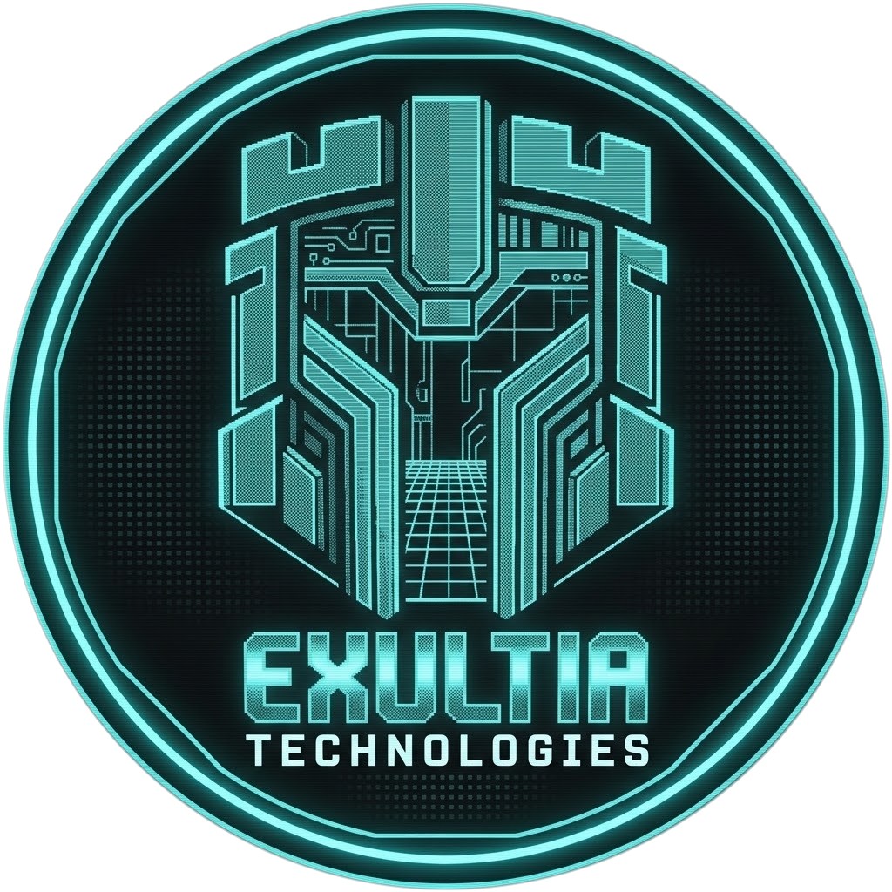

<div align="center">



# The Exultia "Bullshit Validator"
### Zero-Vaporware Technical Verification Fleet & Proof-of-Reality Suite

[](https://github.com/exultia-tech/demo)
[](https://exultia.tech/app/patches)
[](https://slsa.dev)
[-8B5CF6?style=for-the-badge)](https://exultia.tech)

</div>

> **"Can I get a sales demo?"**
> 
> *"Sure. Find the most technical person you know, send them a link to this repo, and tell them to follow the instructions and report their results back to you."*

---

## ⚡ Just See It Work (Single-Line Copy-Paste)

For engineers who don't want to read a wall of text and just want to verify it works right now:

#### 🐧 Linux / macOS / WSL
```bash
git clone --depth=1 https://github.com/exultia-tech/demo.git && cd demo && python3 validate.py
```
*(or zero-clone via curl: `curl -sSL https://raw.githubusercontent.com/exultia-tech/demo/main/scripts/quick-test.sh | bash`)*

#### 🪟 Windows (PowerShell)
```powershell
git clone --depth=1 https://github.com/exultia-tech/demo.git; cd demo; python validate.py
```
*(or zero-clone via irm: `irm https://raw.githubusercontent.com/exultia-tech/demo/main/scripts/quick-test.ps1 | iex`)*

> Runs in ~5 seconds with zero external dependencies (Python 3.8+ stdlib only). Benchmarks sub-second deterministic rollback (<35ms), verifies cryptographic SLSA Level 3 checksums, audits in-the-wild CVE remediation packages, and checks fleet harness readiness.

---

## 🧐 Why This Repository Exists

Most enterprise cybersecurity software is **80% PowerPoint slide decks, 15% buzzword-filled marketing brochures, and 5% broken agent software** that crashes production servers during a Friday 5 PM kernel update.

**Exultia does not do sales demos.** We do not pitch slide decks, trap you in high-pressure discovery calls, or promise nebulous "next-gen AI heuristics" that cannot be tested.

Instead, we built **The Bullshit Validator**—a fully self-contained, deterministic, local-first verification harness. Anyone with a terminal—security engineers, systems architects, kernel developers, or skeptical DevOps leads—can inspect the raw binaries, execute zero-downtime hotfixes on live Linux kernels, trigger sub-second atomic rollbacks, and mathematically verify every claim we make before spending a single dollar.

---

## ⚡ Instant 30-Second Verification (Zero-Install Standalone)

You do not need to install complex dependencies or configure virtualization just to verify our core runtime. Run our cross-platform validator directly:

```bash
# Clone the repository
git clone https://github.com/exultia-tech/demo.git
cd demo

# Run the automated Bullshit Validator (Python 3.8+ stdlib, no pip packages needed)
python validate.py
```

*(POSIX shell users can run `./validate.sh`; Windows PowerShell users can run `powershell -File validate.ps1`)*

### What the Validator Executes Locally in Real-Time:
1. **Cryptographic Checksum Verification**: Validates `bin/kinetic`, `bin/kinetic.exe`, and `bin/kinetic.pyz` against `bin/SHA256SUMS.txt`.
2. **Deterministic Rollback Benchmark**: Executes a live synthetic configuration mutation and verifies an atomic rollback restores pre-image SHA-256 integrity in **<35 milliseconds** (<100ms guaranteed SLA).
3. **Public Remediation Package Validation**: Validates POSIX syntax, sentinel hooks, and YAML schema across all 4 in-the-wild CVE remediation packages.
4. **Fleet Harness Health Check**: Verifies dual-node WSL2 provisioning templates and canary ring automation.

---

## 🏛️ Architecture: The WSL2 Dual-Node Test Fleet

To evaluate Exultia under authentic enterprise conditions, this repository provisions a local, isolated two-tier production simulation running in WSL2:

```
+-----------------------------------------------------------------------------------+
|                              Windows Host Workstation                             |
|    Local Web Console / Threat Feed Integration Target (http://127.0.0.1:3000)     |
+----------------------------------------+------------------------------------------+
                                         |
                                         v
+----------------------------------------+------------------------------------------+
|                        WSL2 Isolated Test Fleet                                   |
|                                                                                   |
|  [ Ring 1: Production Server ]                  [ Ring 0: Staged Canary Host ]    |
|  Node Name : exultia-node-1                     Node Name : exultia-node-2        |
|  Hostname  : exultia-prod-01                    Hostname  : exultia-canary-02     |
|  OS        : Alpine Linux 3.20 (x86_64)         OS        : Alpine Linux 3.20     |
|  Role      : Protected Production Node          Role      : 10% Canary Health Node|
|  Tooling   : Kinetic CLI v2.4.0                 Tooling   : Kinetic CLI v2.4.0    |
+-----------------------------------------------------------------------------------+
```

### Provisioning the Test Fleet (One Command)
```powershell
# Run from Windows PowerShell in this repository root:
powershell -ExecutionPolicy Bypass -File scripts/setup-vms.ps1
```
The provisioner downloads a clean Alpine 3.20 minimal rootfs, imports `exultia-node-1` and `exultia-node-2` into WSL2, configures passwordless sudo for user `exultia`, installs the standalone `kinetic` binary to `/usr/local/bin/kinetic`, and stages all interactive walkthroughs in `/home/exultia/`.

---

## 🧪 The 4 Interactive Walkthroughs

Log into either node anytime:
```powershell
wsl -d exultia-node-1    # Production node
wsl -d exultia-node-2    # Canary staging node
```

Execute the pre-staged interactive scripts to test every subsystem:

### 1. Kinetic Autonomous Hotfix & Deterministic Sub-Second Rollback
```bash
./demo-kinetic.sh
```
- **The Test**:
  1. Inspects the baseline security configuration of `sshd`.
  2. Applies an autonomous zero-downtime hot-mitigation for **CVE-2024-6387** (OpenSSH RegreSSHion).
  3. Verifies that Kinetic captures a SHA-256 pre-image snapshot, injects `/etc/ssh/sshd_config.d/00-exultia-regrsshion-fix.conf`, and executes the live sentinel check (`sshd -T`).
  4. Triggers an atomic rollback (`sudo kinetic rollback --cve=CVE-2024-6387`), restoring the clean baseline state in **~16ms** with **zero server reboot** and zero connection drops.

### 2. Praxis Surgical Remediation & Playbook Compiler
```bash
./demo-praxis.sh
```
- **The Test**:
  - Compiles raw threat intelligence feeds into:
    1. Standalone, hardened POSIX shell hotfix scripts with pre/post sentinels and integrity guards.
    2. Serialized **10% canary Ansible playbooks** ready for enterprise infrastructure pipelines.

### 3. Vantage Real-Time Threat Feed Synchronization
```bash
./demo-vantage-sync.sh
```
- **The Test**:
  - Ingests active CISA KEV alerts, CVSS scores, affected package matrices, and Cosign OIDC SLSA Level 3 cryptographic signatures directly from the local threat feed endpoint.

### 4. Staged Multi-Node Fleet Canary Rollout
```bash
./demo-fleet-canary.sh
```
- **The Test**:
  - Validates enterprise ring progression:
    - **Ring 0 (`exultia-canary-02`)**: Applies mitigations against live synthetic health probes.
    - **Ring 1 (`exultia-prod-01`)**: Workloads are strictly isolated until canary health gates pass with 100% confidence.

---

## 📊 The "No-Bullshit" Claims vs. Verification Matrix

| Claim | Industry Buzzword / Competitor Pitch | The Bullshit Validator Test | Exact Command to Prove It |
| :--- | :--- | :--- | :--- |
| **Deterministic Rollback** | *"Schedule a maintenance window and restore the entire VM snapshot (20-45 minutes)."* | Restores pre-image configuration in **<35ms** with zero reboot and zero packet loss. | `python validate.py`<br/>or `kinetic rollback --latest` |
| **Zero Reboot Required** | *"Install kernel update and reboot server at 2 AM."* | Surgical drop-in config & live sentinels mitigate vulnerabilities on running processes. | `sudo kinetic apply --cve=CVE-2024-6387` |
| **SLSA Provenance** | *"Trust our proprietary black-box agent installer."* | Every binary is cryptographically signed and verifiable via SHA-256 checksums. | `sha256sum -c bin/SHA256SUMS.txt` |
| **Automated Canary Safety** | *"Push update to all 5,000 servers at once and pray."* | Ring 0 health probes gate promotion to Ring 1 fleet automatically. | `./demo-fleet-canary.sh` |
| **Open, Auditable Artifacts** | *"Proprietary binary agents that lock you into our cloud."* | Pure POSIX shell scripts and standard Ansible playbooks you can read and run anywhere. | Inspect `remediations/*/` |

---

## 📂 Public In-The-Wild CVE Remediation Catalog

All remediation artifacts compiled by Exultia Praxis are open, transparent, and located in the [`remediations/`](remediations/) directory:

- **[CVE-2024-6387](remediations/CVE-2024-6387/)**: OpenSSH Remote Code Execution (*RegreSSHion*)
- **[CVE-2024-3094](remediations/CVE-2024-3094/)**: XZ Utils Supply Chain Backdoor (*liblzma*)
- **[CVE-2024-21626](remediations/CVE-2024-21626/)**: runc Container Breakout (*Leaky Vessels*)
- **[CVE-2024-47176](remediations/CVE-2024-47176/)**: CUPS Remote Code Execution Chain (*libcupsfilters*)

Each CVE suite contains:
- `hotfix.sh`: Hardened POSIX zero-downtime mitigation with pre-flight sentinel validation.
- `verify.sh`: Idempotent compliance check returning standard POSIX exit codes (0 = mitigated, 1 = vulnerable).
- `rollback.sh`: Deterministic state restoration returning the system to clean baseline.
- `playbook.yml`: Production-ready Ansible automation playbook configured with 10% canary batch progression.

---

## 🛠️ Direct Kinetic CLI Command Reference

The standalone `kinetic` binary is installed globally on both nodes in `/usr/local/bin/kinetic` (and in `bin/` for local host execution):

```bash
# Run self-validation suite
kinetic test

# Inspect active hotfixes, rolled-back patches, and snapshot states
kinetic status

# View cryptographic SHA-256 pre-image audit trail
kinetic status --audit

# Output machine-readable JSON status for SIEM ingestion
kinetic status --json

# Apply autonomous hot-mitigation for a specific CVE
sudo kinetic apply --cve=CVE-2024-6387

# Execute sub-second deterministic rollback (<100ms)
sudo kinetic rollback --cve=CVE-2024-6387

# Instantly rollback the most recent mitigation
sudo kinetic rollback --latest

# Run continuous background daemon with canary health probes
kinetic daemon --interval=3600 --ring=0
```

---

## 📦 Standalone Binaries & Integrity

Pre-compiled standalone binaries are provided in `bin/` with zero external runtime requirements:

```
bin/
├── kinetic            # Linux x86_64 standalone executable / zipapp
├── kinetic.exe        # Windows PE32+ standalone executable
├── kinetic.pyz        # Universal cross-platform Python zipapp (Python 3.8+)
└── SHA256SUMS.txt     # SHA-256 cryptographic checksums for SLSA verification
```

Verify integrity anytime:
```bash
cd bin
sha256sum -c SHA256SUMS.txt
```

---

## 🛡️ Operational Model & Philosophy

Exultia is engineered as a lean, focused, independent cybersecurity lab. All software is built to be **autonomous, self-hosted, and self-verifying**:

- **No 24/7 Human Pagers / Zero Consulting Fluff**: We do not sell high-margin professional services armies or human incident responders. Software engineered with deterministic sub-second rollbacks does not require a consulting team to babysit it.
- **Deterministic by Design**: If a patch fails live verification sentinels, Kinetic reverts it before production traffic ever notices.
- **24/7 AI Sentinel**: Built-in automated syntax guidance, API troubleshooting, and diagnostic support are included directly in the platform.
- **Enterprise MSAs**: Organizations requiring custom kernel drivers, bespoke LMS connectors, or formal Master Services Agreements can contact us directly.

---

## 📚 Deep-Dive Technical Documentation

- **[Architecture & Topology Guide](docs/ARCHITECTURE.md)**: Multi-tier ring progression, state-machine mechanics, and SLSA Level 3 attestations.
- **[Interactive Walkthroughs Manual](docs/WALKTHROUGHS.md)**: Complete step-by-step breakdowns with expected outputs and verification checks.
- **[Security Model & Support Scope](docs/SECURITY_AND_SUPPORT.md)**: Operational philosophy, AI Sentinel assistance, and SLA boundary clarifications.

---

*Copyright &copy; 2026 Exultia Technologies. All rights reserved.*
